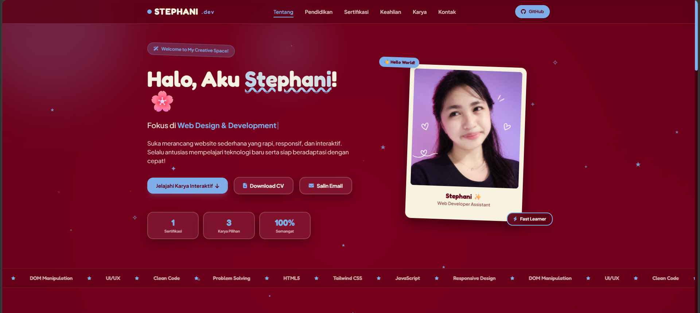

# 🌸 Stephani | Interactive Web Portfolio

> Portofolio pribadi interaktif yang menampilkan karya, sertifikasi resmi, latar belakang pendidikan, serta keahlian di bidang pengembangan web dan sistem informasi.

Website ini dirancang dengan gaya modern, responsif, dan interaktif menggunakan palet warna khas *Night Bordeaux* dan *Cool Horizon*.

---

## Fitur Utama

* **🎨 Modern & Playful UI/UX**: Dilengkapi dengan animasi latar belakang (bintang/efek partikel), efek kemiringan kartu 3D (*Tilt Effect*), dan *Dark/Bordeaux Aesthetic*.
* **⚡ Interactive Typing Effect**: Menampilkan peran dan fokus keahlian secara dinamis di bagian *Hero*.
* **📂 Filter & Quick Specs Proyek**: Pengunjung dapat memfilter karya berdasarkan kategori (*Web Design* / *Web App*) atau langsung mengeklik tag teknologi (`#HTML`, `#Tailwind`, `#JavaScript`).
* **🏆 Sertifikasi Kompetensi Interaktif**: Dilengkapi modal interaktif untuk melihat rincian sertifikasi resmi sebagai Asisten Pemrograman Web.
* **📋 Fitur Salin Email Cepat**: Tombol salin email praktis dengan efek animasi konfeti interaktif.

---

##  Teknologi yang Digunakan

* **HTML5** – Struktur dasar web semantik.
* **Tailwind CSS** – Styling responsif, kustomisasi tema, dan utilitas modern.
* **JavaScript (ES6+)** – Manipulasi DOM, sistem filter interaktif, efek *typing*, modal, dan animasi *tilt*.
* **Font & Icons**: Plus Jakarta Sans, Fredoka (Google Fonts), dan Font Awesome.

---

##  Daftar Proyek Pilihan

1. **Portofolio Stephani** *(Web Design)*: Website portofolio interaktif pribadi.
2. **LocaPic App** *(Web App)*: Aplikasi galeri/foto interaktif dengan antarmuka yang bersih dan mudah digunakan.
3. **Cardio-Bayes** *(Web App)*: Aplikasi berbasis web untuk prediksi dini risiko serangan jantung berdasarkan data dan kebiasaan (*habit*).

---



## Cara Menjalankan Secara Lokal (Local Development)

Jika Anda ingin melihat atau mengembangkan ulang kode ini di komputer lokal Anda melalui **VS Code**:

1. **Clone repository ini:**
   ```bash
   git clone [https://github.com/stephani689/Portofolio-Stephani.git](https://github.com/stephani689/Portofolio-Stephani.git)
